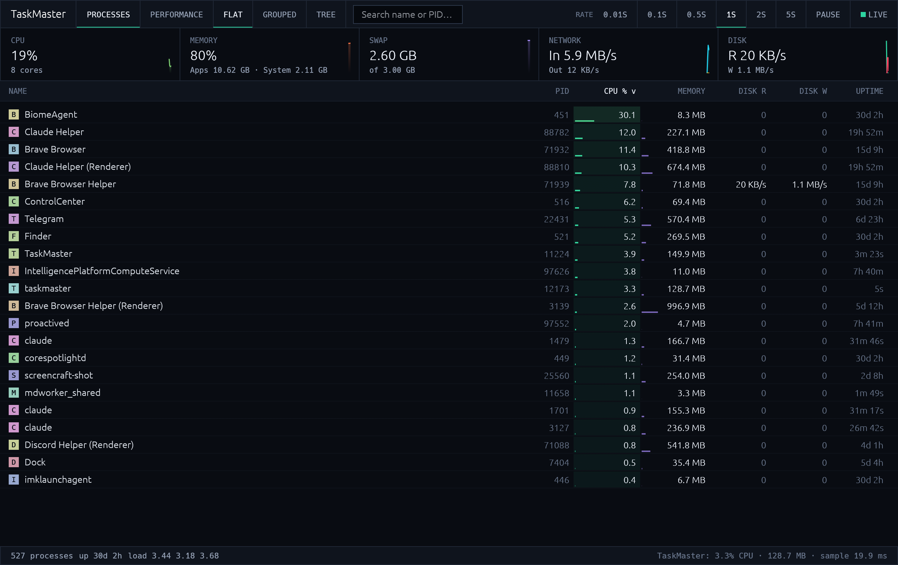

<p align="center">
  
</p>

<h1 align="center">TaskMaster</h1>

<p align="center">
  <b>Every process. Live.</b><br>
  A tiny, fast task manager that updates in real time and idles near zero.<br>
  100% Rust and egui, for macOS (Windows is next).
</p>

<p align="center">
  
  
  
  
</p>

<p align="center">
  <a href="https://taskmaster.mdnlabs.dev/download"><b>Download</b></a> ·
  <a href="https://taskmaster.mdnlabs.dev">Website</a> ·
  <a href="https://github.com/MarshallNickolauson/TaskMaster/releases">Releases</a>
</p>



## What it does

- **Live process table**: PID, CPU, memory, disk read/write and uptime, sortable and searchable, with heat bars that show what is burning resources.
- **Flat, Grouped or Tree**: collapse helper processes into their app, or follow the parent/child tree.
- **Summary strip**: CPU, memory, swap, network and disk with sparklines, always visible.
- **Performance tab**: two minutes of history for CPU, per-core load, memory, network and disk.
- **Process inspector**: per-process CPU and memory history, parent (click to jump), path and full command line.
- **End task / Force quit**, always with a confirmation.

## Light on resources

A monitor should not be the thing that slows your machine down.

- A dedicated sampler thread refreshes only what the table shows (CPU, memory, disk) and blocks on a channel between samples.
- The UI repaints only when a new sample arrives or you interact. No animation loop.
- **Eco mode**: slows sampling when another app has focus and stops it entirely when minimized or paused.
- Refresh rate is yours to pick: 0.01, 0.1, 0.5, 1, 2 or 5 seconds.
- The status bar shows TaskMaster's own CPU, memory and per-sample cost, live.

## Using it

| Do this | To get this |
| --- | --- |
| Click a column header | Sort (click again to reverse) |
| <kbd>⌘F</kbd> / <kbd>Ctrl+F</kbd> | Search by name or PID |
| Click a row, <kbd>↑</kbd> / <kbd>↓</kbd> | Select and inspect |
| <kbd>Delete</kbd> or right-click → End task… | End the selected process (asks first) |
| <kbd>Esc</kbd> | Clear search and dialogs |
| Pause / rate buttons | Freeze the view or change the refresh rate |

Ending processes owned by other users or the system needs matching privileges; TaskMaster tells you when the OS says no.

## Install

```bash
curl -fsSL https://taskmaster.mdnlabs.dev/install.sh | bash
```

Or grab the `.dmg` (Apple silicon and Intel) from the [releases page](https://github.com/MarshallNickolauson/TaskMaster/releases). It is unsigned, so right-click → Open the first time.

### Build from source

You need [Rust](https://rustup.rs) 1.85 or newer.

```bash
git clone https://github.com/MarshallNickolauson/TaskMaster.git
cd TaskMaster
cargo run --release
```

## How it is built

| File | Job |
| --- | --- |
| [`src/stats.rs`](src/stats.rs) | Sampler thread around [sysinfo](https://github.com/GuillaumeGomez/sysinfo): adaptive interval, kill commands, snapshots |
| [`src/widgets.rs`](src/widgets.rs) | Colors, formatting, sparklines and area charts |
| [`src/main.rs`](src/main.rs) | The egui app: table, inspector, performance tab |
| [`scripts/make-icon.py`](scripts/make-icon.py) | Generates the logo (SVG and PNG) |

Three direct dependencies (`eframe`, `sysinfo`, `image`), one binary of about 4 MB. Windows support is planned; the code is already cross-platform.

The site in [`website/`](website) is static HTML, CSS and a little JavaScript, including a live simulated demo. Deploy with `npx wrangler pages deploy website --project-name taskmaster`.

## License

[MIT](LICENSE) © 2026 Marshall Nickolauson. Part of [mdnlabs](https://mdnlabs.dev).
